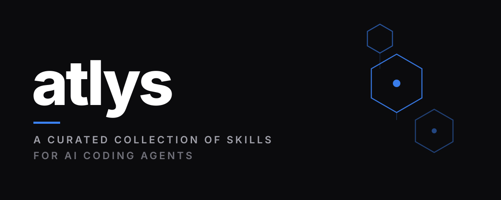
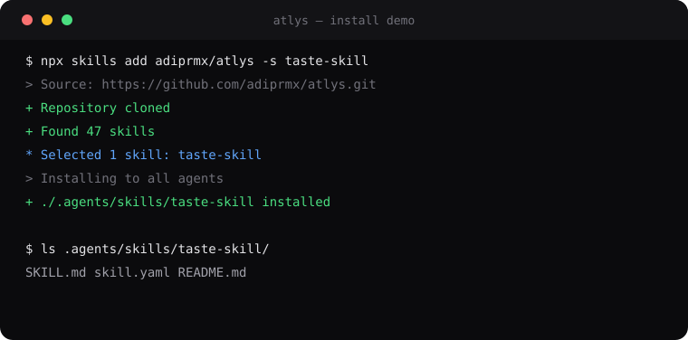
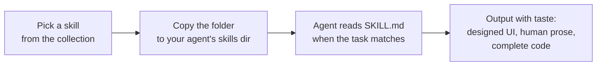
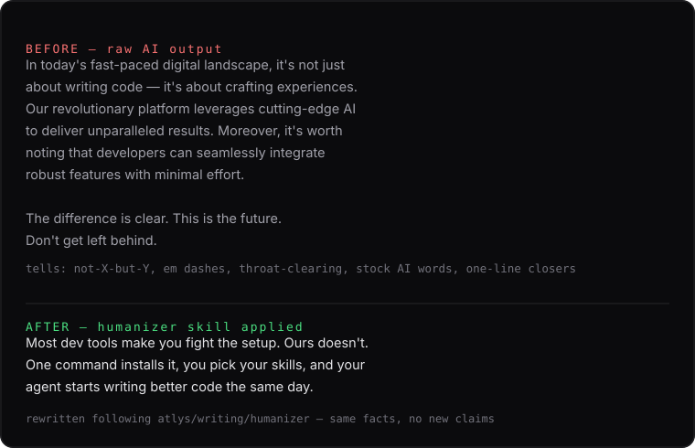
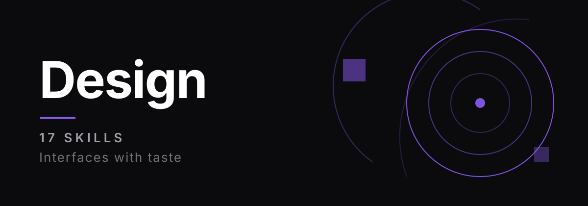
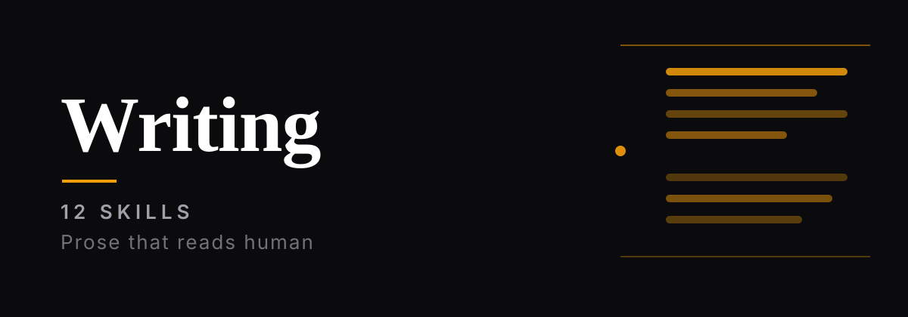
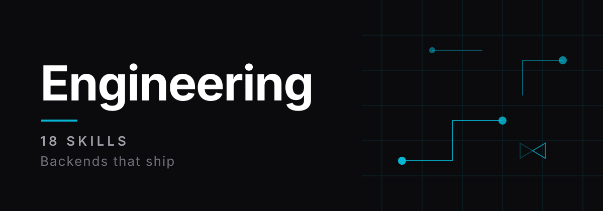
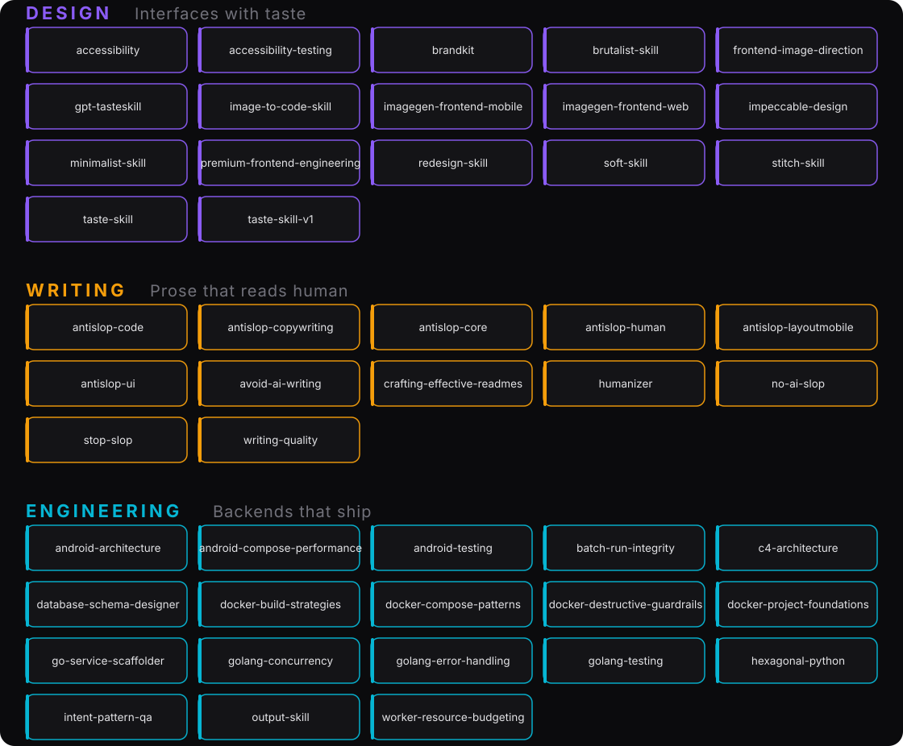

<div align="center">

**A curated collection of skills for AI coding agents.**

[](https://github.com/adiprmx/atlys)
[](https://github.com/adiprmx/atlys/actions/workflows/validate.yml)
[](https://github.com/adiprmx/atlys/releases)
[](LICENSE)
[](https://skills.sh/adiprmx/atlys)

*Design taste, anti-slop writing, and engineering QA — as drop-in playbooks.*

</div>

---

## Install

```sh
npx skills add adiprmx/atlys
```

Pick the skills you want, pick your agent (Claude Code, Cursor, Codex, …), done. If atlys saves you an afternoon, a star helps others find it.

```sh
npx skills add adiprmx/atlys -s taste-skill   # one skill only
```

Manual: `git clone https://github.com/adiprmx/atlys.git`, then copy any folder to your agent's skills dir (`~/.claude/skills/`).



### Start here

**Interfaces** — `taste-skill` + `antislop-core`. Add `redesign-skill` for existing work, `accessibility` before you ship.
**Writing** — `antislop-core` + `humanizer` + `stop-slop`.
**Backends** — `hexagonal-python` (or `golang-*`) + `docker-compose-patterns` + `output-skill`.

You don't need all 47 — take what matches your work.

Only want one category? Clone it sparsely:

```sh
git clone --filter=blob:none --sparse https://github.com/adiprmx/atlys.git
cd atlys && git sparse-checkout set design
```

Then tell your agent to load the skill when relevant — or wire it into your agent's skill discovery so it's picked up automatically. Every skill ships with `SKILL.md` frontmatter (`name`, `description`) so agents that auto-index skills just work.

### How it works



A skill is a self-contained folder:

```
design/taste-skill/
├── SKILL.md        # the playbook: when to load it, how to apply it
├── skill.yaml      # machine-readable metadata (name, description)
└── scripts/        # optional helper scripts (only some skills)
```

`SKILL.md` starts with frontmatter (`name`, `description`, `allowed-tools`) so agents can index and auto-load it. Everything else is plain markdown written to be read by both humans and models.

## The bar

Every skill here earned its place: it must visibly change the agent's output, be specific (rules and examples, not vague advice), and respect the reader (no filler). Thin or duplicated skills get cut.



## What's inside

| [](design/) | [](writing/) | [](engineering/) |
|:---:|:---:|:---:|
| **Design** — interfaces with taste<br/><sub>Start with `taste-skill` · `impeccable-design`</sub> | **Writing** — prose that reads human<br/><sub>Start with `antislop-core` · `humanizer`</sub> | **Engineering** — backends that ship<br/><sub>Start with `output-skill` · `hexagonal-python`</sub> |

<details>
<summary><strong>Design & frontend</strong> — <a href="design/">design/</a> · 17 skills</summary>

| Skill | What it does |
|---|---|
| `taste-skill` | Anti-slop frontend for landing pages, portfolios, and redesigns. Reads the brief, infers the right design direction, and ships interfaces that don't look templated. Strict pre-flight check included. |
| `taste-skill-v1` | The original v1 of taste-skill, preserved for projects depending on its exact behavior. |
| `redesign-skill` | Upgrades existing websites and apps without breaking functionality. Audit-first; hunts down generic AI patterns. |
| `soft-skill` | Agency-grade polish: exact fonts, spacing, shadows, card structures, and animations that make a site feel expensive. |
| `minimalist-skill` | Clean editorial interfaces — warm monochrome, typographic contrast, flat bento grids. No gradients, no heavy shadows. |
| `brutalist-skill` | Raw mechanical interfaces fusing Swiss typographic print with military terminal aesthetics. For data-heavy dashboards and portfolios that should feel like declassified blueprints. |
| `stitch-skill` | Semantic design-system skill for Google Stitch. Generates agent-friendly `DESIGN.md` files enforcing anti-generic UI standards. |
| `brandkit` | Brand-kit image generation: logo systems, identity decks, and brand-guideline boards across minimalist, cinematic, editorial, dark-tech, luxury, and more. |
| `gpt-tasteskill` | UX/UI plus advanced GSAP motion engineering — AIDA page structure, wide editorial typography, gapless bento grids, strict ScrollTriggers. |
| `imagegen-frontend-web` | Generates conversion-aware website design references — one horizontal image per section, one consistent palette. |
| `imagegen-frontend-mobile` | Mobile app screen concepts and flows (iOS/Android/cross-platform), presented in phone mockups. Image generation only. |
| `frontend-image-direction` | Section references, mobile screen concepts, and brand-consistent image sets with locked cross-image consistency — then implements from the references without design drift. |
| `image-to-code-skill` | Generates the design images first, analyzes them deeply, then implements the website to match as closely as possible. |
| `premium-frontend-engineering` | Hand-coded frontend: brief-driven design dials, bias-corrected typography and color, intentional GSAP/Motion choreography, strict pre-flight check. |
| `impeccable-design` | Full-spectrum frontend improvement — UX review, visual hierarchy, accessibility, responsive behavior, theming, anti-patterns — plus live-browser iteration on real UI. |
| `accessibility` | Web accessibility and usability QA, especially for users with disabilities. Expert-curated guidance that catches the common pitfalls in AI-generated markup. |
| `accessibility-testing` | Practical methodology for testing the accessibility of a web project. |

</details>

<details>
<summary><strong>Anti-AI-slop writing</strong> — <a href="writing/">writing/</a> · 12 skills</summary>

| Skill | What it does |
|---|---|
| `antislop-core` | The core filter. Rules every AI coding agent should follow to stop generic AI slop. Load always. |
| `antislop-ui` | The visual companion to the core: color, layout, components, and motion without the slop. |
| `antislop-copywriting` | Headlines, tone, CTAs, and anti-AI-writing patterns for prose that persuades. |
| `antislop-code` | Code comment hygiene: strip generic AI-slop comments, keep the valuable ones, never touch the code. |
| `antislop-human` | Human-first and accessible: contrast, keyboard, focus, and states for real people. Ships a contrast checker. |
| `antislop-layoutmobile` | Layouts that reflow gracefully from phone to desktop: grids, overflow, tap targets. |
| `humanizer` | Turns AI-scented writing into human-sounding prose without changing the content. Built on Wikipedia's *"Signs of AI writing"* research. |
| `stop-slop` | Cuts AI rhetoric and filler: 8 core rules, banned-phrase lists, quick checks, and per-dimension scoring. |
| `no-ai-slop` | Two modes — **Edit** (minimum effective edit, with a changelog) and **Detect** (name the pattern, quote the line, suggest the fix). |
| `avoid-ai-writing` | A strict editing contract (detect ≠ judge ≠ edit), tiered pattern catalog, voice profiles, and iterate-to-convergence passes. |
| `crafting-effective-readmes` | README writing matched to your audience — templates and guidance for READMEs that actually get read. |
| `writing-quality` | Applies to every turn that drafts human-facing prose (chat replies, explanations, emails). Quality from a different angle than de-slopping. |

</details>

<details>
<summary><strong>Engineering & QA</strong> — <a href="engineering/">engineering/</a> · 18 skills</summary>

| Skill | What it does |
|---|---|
| `output-skill` | Overrides default LLM truncation behavior. Enforces complete code generation, bans placeholder patterns, and handles token-limit splits cleanly. |
| `intent-pattern-qa` | Catches silent regex-pattern death — patterns that compile but never match — via positive-match probes and byte-level asserts. |
| `batch-run-integrity` | Keeps long multi-chunk batch jobs honest and resumable: incremental on-disk checkpoints, completion claims reconciled against artifacts on disk. |
| `worker-resource-budgeting` | Budgets RAM before fanning out parallel workers, so verification workers never starve the live system. |
| `hexagonal-python` | Hexagonal Architecture (Ports & Adapters) + DDD for Python backends (FastAPI/Flask, SQLAlchemy, pytest): use cases, aggregates, repositories, unit of work, domain events. |
| `docker-compose-patterns` | Docker Compose done right: service definitions, health checks, dependency ordering, volumes, networks, env vars, dev overrides. |
| `docker-build-strategies` | Writing, reviewing, and optimizing Dockerfiles: image size, build speed, layer caching, multi-stage builds. |
| `docker-project-foundations` | Setting up and Dockerizing a project from scratch: scaffolding, configuration, conventions. |
| `docker-destructive-guardrails` | Guardrails to check before running — or recommending — any Docker command that deletes, wipes, or irreversibly changes state. |
| `golang-concurrency` | Go concurrency design: goroutine lifecycle and leak prevention, channels and `select`, mutexes, `errgroup`, worker pools, fan-out/fan-in. |
| `golang-error-handling` | Idiomatic Go error handling: wrapping with `%w`, `errors.Is`/`As`/`Join`, custom types, sentinel errors, panic/recover. |
| `golang-testing` | Production-ready Go tests: table-driven tests, testify suites and mocks, parallel tests, fuzzing, fixtures. |
| `database-schema-designer` | DB schema design for SQL and NoSQL: normalization, indexing strategies, migration patterns, with examples. |
| `c4-architecture` | Architecture documentation with C4-model Mermaid diagrams: context, container, component, code. |
| `go-service-scaffolder` | Scaffolds production-ready Go HTTP services: OpenTelemetry, TLS, lifecycle management, Dockerfile, GitHub Actions CI. |
| `android-architecture` | Modern Android app architecture with Clean Architecture + Hilt: strict layering, setup and maintenance guidance. |
| `android-compose-performance` | Audits and improves Jetpack Compose runtime performance — diagnoses slow rendering and jank from code review. |
| `android-testing` | Android testing strategy: unit, integration, Hilt, and screenshot tests. |

</details>

> **47 skills so far.** The list grows when something new earns its place.

### Skill map



Machine-readable index: [`skills.json`](skills.json) · [`llms.txt`](llms.txt)

<details>
<summary><strong>Credits & sources</strong></summary>

atlys is curated and maintained by [ **adiprmx**](https://github.com/adiprmx) — skill selection, naming, `skill.yaml` metadata, Indonesian-language adaptations, and ongoing expansion of select skills.

Several skills are adapted from excellent open-source work. They retain their original licenses (see each skill folder), and this collection wouldn't exist without them:

- `antislop-*` family — [miqdadbadjuber/anti-slop](https://github.com/miqdadbadjuber/anti-slop)
- `taste-skill` family (`taste-skill`, `redesign-skill`, `soft-skill`, `minimalist-skill`, `brutalist-skill`, `stitch-skill`, `brandkit`, `gpt-tasteskill`, `imagegen-frontend-web`, `imagegen-frontend-mobile`, `frontend-image-direction`, `image-to-code-skill`, `premium-frontend-engineering`, `output-skill`) — [Leonxlnx/taste-skill](https://github.com/Leonxlnx/taste-skill)
- `humanizer` — [blader/humanizer](https://github.com/blader/humanizer)
- `stop-slop` — [hardikpandya/stop-slop](https://github.com/hardikpandya/stop-slop)
- `no-ai-slop` — [petergyang/no-ai-slop](https://github.com/petergyang/no-ai-slop)
- `avoid-ai-writing` — [conorbronsdon/avoid-ai-writing](https://github.com/conorbronsdon/avoid-ai-writing)
- `impeccable-design` — originally [pbakaus/impeccable](https://github.com/pbakaus/impeccable), significantly expanded
- `hexagonal-python` — [Remy349/skills](https://github.com/Remy349/skills) (MIT)
- `docker-*` family — [docker/skills](https://github.com/docker/skills) (Apache-2.0)
- `golang-*` family — [samber/cc-skills-golang](https://github.com/samber/cc-skills-golang) (MIT)
- `accessibility`, `accessibility-testing` — [KreerC/ACCESSIBILITY.md](https://github.com/KreerC/ACCESSIBILITY.md) (MIT)
- `database-schema-designer`, `c4-architecture`, `crafting-effective-readmes` — [softaworks/agent-toolkit](https://github.com/softaworks/agent-toolkit) (MIT)
- `go-service-scaffolder`, `writing-quality` — [ItalyPaleAle/skills](https://github.com/ItalyPaleAle/skills) (MIT)
- `android-*` family — [new-silvermoon/awesome-android-agent-skills](https://github.com/new-silvermoon/awesome-android-agent-skills) (Apache-2.0)

</details>

## Contributing

See [CONTRIBUTING.md](CONTRIBUTING.md) — the bar, the folder layout, and how to author a skill that passes.

## License

MIT — see [LICENSE](LICENSE). Skills adapted from external sources keep their original licenses (MIT/Apache-2.0, both commercial-friendly).
