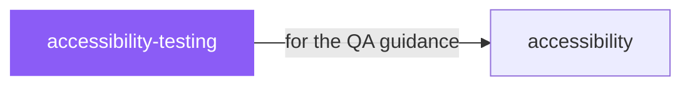

# accessibility-testing

 

*A checklist you run once isn't a methodology. This is the repeatable process for proving a project is actually accessible.*

Use for testing the accessibility of a web project

## When to use

- Setting up a repeatable accessibility testing methodology
- You need a process, not just a checklist

## Contents

```
accessibility-testing/
└── SKILL.md  # the playbook — when to load, how to apply
```

## Pairs well with



Also: [`accessibility`](../design/accessibility/)

## Install

```sh
cp -r design/accessibility-testing ~/.claude/skills/  # or your agent's skills directory
```

## Source

Adapted from [KreerC/ACCESSIBILITY.md](https://github.com/KreerC/ACCESSIBILITY.md) (MIT), curated into atlys by [adiprmx](https://github.com/adiprmx).

---

Part of [atlys](../../) — a curated collection of skills for AI coding agents.
