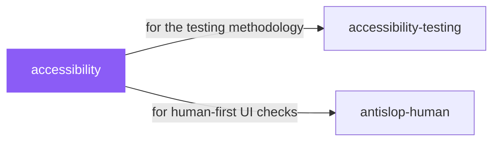

# accessibility

 

*AI-generated markup fails accessibility in predictable ways — divs as buttons, missing labels, contrast that looks fine until it isn't. This is the expert QA pass that catches them.*

Quality assurance for web accessibility and usability, particularly for users with disabilities. Use when involved in any web project.

## When to use

- QA pass on a web project for users with disabilities
- Catching the accessibility pitfalls AI-generated markup usually has

## Contents

```
accessibility/
└── SKILL.md  # the playbook — when to load, how to apply
```

## Pairs well with



Also: [`accessibility-testing`](../accessibility-testing/), [`antislop-human`](../../writing/antislop-human/)

## Install

```sh
cp -r design/accessibility ~/.claude/skills/  # or your agent's skills directory
```

## Source

Adapted from [KreerC/ACCESSIBILITY.md](https://github.com/KreerC/ACCESSIBILITY.md) (MIT), curated into atlys by [adiprmx](https://github.com/adiprmx).

---

Part of [atlys](../../) — a curated collection of skills for AI coding agents.
