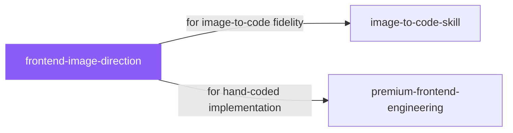

# frontend-image-direction

 

*The usual failure: beautiful references, an implementation that drifts into something else. This locks the visual direction across images, then carries it into code without the drift.*

Generate premium website section references, mobile app screen concepts, and brand-consistent image sets with one image per section or screen, locked cross-image consistency, and anti-generic art direction, then implement from the references without design drift.

## When to use

- You want image references and implementation without design drift
- Multi-screen projects that need locked visual consistency

## Contents

```
frontend-image-direction/
├── SKILL.md  # the playbook — when to load, how to apply
└── skill.yaml  # machine-readable metadata
```

## Pairs well with



Also: [`image-to-code-skill`](../design/image-to-code-skill/), [`premium-frontend-engineering`](../design/premium-frontend-engineering/)

## Install

```sh
cp -r design/frontend-image-direction ~/.claude/skills/  # or your agent's skills directory
```

## Source

Adapted from [Leonxlnx/taste-skill](https://github.com/Leonxlnx/taste-skill) (MIT), curated into atlys by [adiprmx](https://github.com/adiprmx).

---

Part of [atlys](../../) — a curated collection of skills for AI coding agents.
