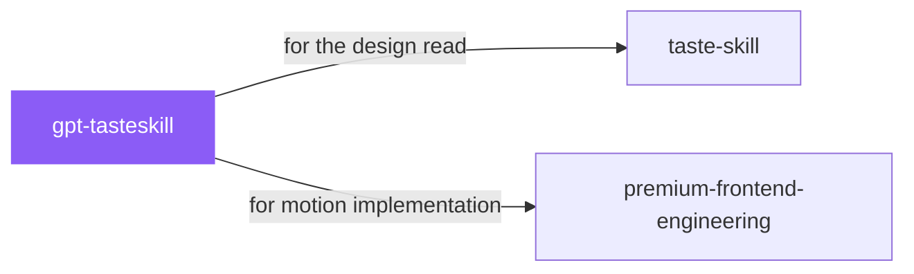

# gpt-tasteskill

 

*Landing pages live or die on motion and rhythm. This is the full choreography: AIDA structure, editorial type, GSAP scroll work that feels intentional instead of decorative.*

Elite UX and UI plus advanced GSAP motion engineering with AIDA page structure, wide editorial typography, gapless bento grids, and strict GSAP ScrollTriggers.

## When to use

- Landing pages with advanced GSAP motion and scroll choreography
- AIDA-structured pages with wide editorial typography

## Contents

```
gpt-tasteskill/
├── SKILL.md  # the playbook — when to load, how to apply
└── skill.yaml  # machine-readable metadata
```

## Pairs well with



Also: [`taste-skill`](../taste-skill/), [`premium-frontend-engineering`](../premium-frontend-engineering/)

## Install

```sh
cp -r design/gpt-tasteskill ~/.claude/skills/  # or your agent's skills directory
```

## Source

Adapted from [Leonxlnx/taste-skill](https://github.com/Leonxlnx/taste-skill) (MIT), curated into atlys by [adiprmx](https://github.com/adiprmx).

---

Part of [atlys](../../) — a curated collection of skills for AI coding agents.
