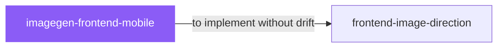

# imagegen-frontend-mobile

 

*Mobile flows are hard to judge from descriptions. See the screens first — in phone frames, with a consistent hand — then decide what to build.*

Elite mobile app image-generation skill for creating premium, app-native screen concepts and flows. Designed for iOS, Android, and cross-platform mobile products.

## When to use

- Concepting mobile app screens (iOS/Android) as image references
- Exploring app flows before committing to code

## Contents

```
imagegen-frontend-mobile/
├── SKILL.md  # the playbook — when to load, how to apply
└── skill.yaml  # machine-readable metadata
```

## Pairs well with



Also: [`frontend-image-direction`](../design/frontend-image-direction/)

## Install

```sh
cp -r design/imagegen-frontend-mobile ~/.claude/skills/  # or your agent's skills directory
```

## Source

Adapted from [Leonxlnx/taste-skill](https://github.com/Leonxlnx/taste-skill) (MIT), curated into atlys by [adiprmx](https://github.com/adiprmx).

---

Part of [atlys](../../) — a curated collection of skills for AI coding agents.
