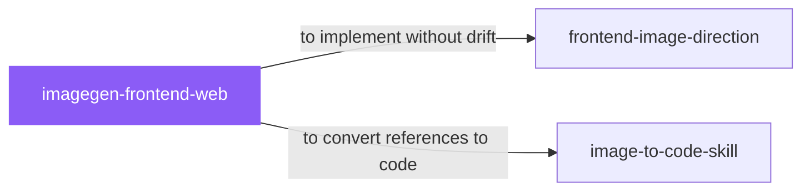

# imagegen-frontend-web

 

*Coding straight from a blank brief is how you get template number four thousand. Generate the design direction as images first, agree on the look, then build.*

Elite frontend image-direction skill for generating premium, conversion-aware website design references, one separate horizontal image per section, with composition variety and a single consistent palette.

## When to use

- You want AI-generated design references before coding a website
- You need one consistent visual direction across all page sections

## Contents

```
imagegen-frontend-web/
├── SKILL.md  # the playbook — when to load, how to apply
└── skill.yaml  # machine-readable metadata
```

## Pairs well with



Also: [`frontend-image-direction`](../frontend-image-direction/), [`image-to-code-skill`](../image-to-code-skill/)

## Install

```sh
cp -r design/imagegen-frontend-web ~/.claude/skills/  # or your agent's skills directory
```

## Source

Adapted from [Leonxlnx/taste-skill](https://github.com/Leonxlnx/taste-skill) (MIT), curated into atlys by [adiprmx](https://github.com/adiprmx).

---

Part of [atlys](../../) — a curated collection of skills for AI coding agents.
