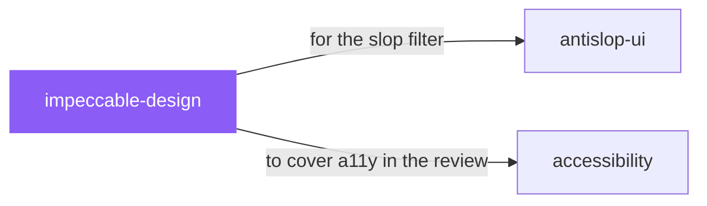

# impeccable-design

 

*The full teardown: UX, hierarchy, accessibility, responsive, theming, anti-patterns. Then iterate on the real thing in a live browser, not in theory.*

Use when the user wants to design, redesign, shape, critique, audit, polish, clarify, distill, harden, optimize, adapt, animate, colorize, extract, or otherwise improve a frontend interface. Covers websites, landing pages, dashboards, product UI, app shells, components, forms, settings, onboarding, and empty states.

## When to use

- A full review pass: UX, hierarchy, accessibility, responsive behavior, theming
- Iterating on a live UI in the browser with real feedback

## Contents

```
impeccable-design/
├── agents/  # subagent definitions
├── reference/  # reference docs
├── scripts/  # helper scripts
└── SKILL.md  # the playbook — when to load, how to apply
```

## Pairs well with



Also: [`antislop-ui`](../../writing/antislop-ui/), [`accessibility`](../accessibility/)

## Install

```sh
cp -r design/impeccable-design ~/.claude/skills/  # or your agent's skills directory
```

## Source

Adapted from [pbakaus/impeccable](https://github.com/pbakaus/impeccable) (MIT), curated into atlys by [adiprmx](https://github.com/adiprmx).

---

Part of [atlys](../../) — a curated collection of skills for AI coding agents.
