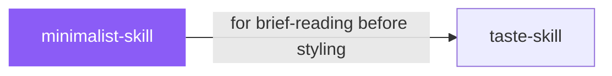

# minimalist-skill

 

*Minimalism isn't empty. It's confidence — warm monochrome, type doing the heavy lifting, nothing decorative. For when the content deserves the spotlight.*

Clean editorial-style interfaces. Warm monochrome palette, typographic contrast, flat bento grids, muted pastels.

## When to use

- Editorial or content-focused interfaces
- You want warm monochrome, strong typography, zero visual noise

## Contents

```
minimalist-skill/
├── SKILL.md  # the playbook — when to load, how to apply
└── skill.yaml  # machine-readable metadata
```

## Pairs well with



Also: [`taste-skill`](../taste-skill/)

## Install

```sh
cp -r design/minimalist-skill ~/.claude/skills/  # or your agent's skills directory
```

## Source

Adapted from [Leonxlnx/taste-skill](https://github.com/Leonxlnx/taste-skill) (MIT), curated into atlys by [adiprmx](https://github.com/adiprmx).

---

Part of [atlys](../../) — a curated collection of skills for AI coding agents.
