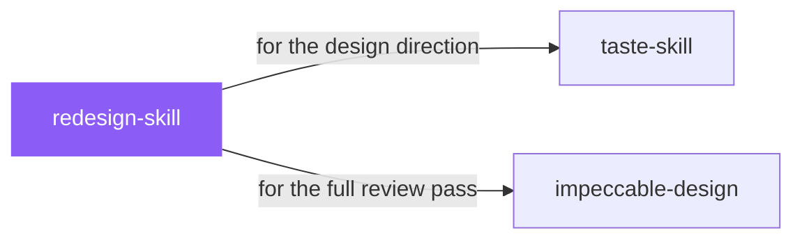

# redesign-skill

 

*Redesigns usually fail two ways: they break what worked, or they change nothing that matters. This skill audits first, then upgrades — keeping the bones, fixing the taste.*

Upgrades existing websites and apps to premium quality. Audits current design, identifies generic AI patterns, and applies high-end design standards without breaking functionality.

## When to use

- Upgrading an existing site or app's visual quality without breaking functionality
- Auditing a UI for generic AI patterns before shipping

## Contents

```
redesign-skill/
├── SKILL.md  # the playbook — when to load, how to apply
└── skill.yaml  # machine-readable metadata
```

## Pairs well with



Also: [`taste-skill`](../taste-skill/), [`impeccable-design`](../impeccable-design/)

## Install

```sh
cp -r design/redesign-skill ~/.claude/skills/  # or your agent's skills directory
```

## Source

Adapted from [Leonxlnx/taste-skill](https://github.com/Leonxlnx/taste-skill) (MIT), curated into atlys by [adiprmx](https://github.com/adiprmx).

---

Part of [atlys](../../) — a curated collection of skills for AI coding agents.
