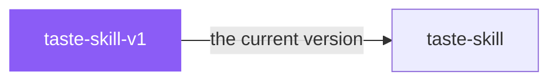

# taste-skill-v1

 

*Kept around for one reason: some projects were built on v1 and still depend on its exact behavior. If that's not you, use taste-skill.*

The original v1 taste-skill, preserved for projects depending on its exact behavior. The current default is `design-taste-frontend` (v2 experimental), which is a substantial rewrite.

## When to use

- You need the exact behavior of the original v1 taste-skill
- An existing project was built with v1 and you want consistency

## Contents

```
taste-skill-v1/
├── SKILL.md  # the playbook — when to load, how to apply
└── skill.yaml  # machine-readable metadata
```

## Pairs well with



Also: [`taste-skill`](../taste-skill/)

## Install

```sh
cp -r design/taste-skill-v1 ~/.claude/skills/  # or your agent's skills directory
```

## Source

Adapted from [Leonxlnx/taste-skill](https://github.com/Leonxlnx/taste-skill) (MIT), curated into atlys by [adiprmx](https://github.com/adiprmx).

---

Part of [atlys](../../) — a curated collection of skills for AI coding agents.
