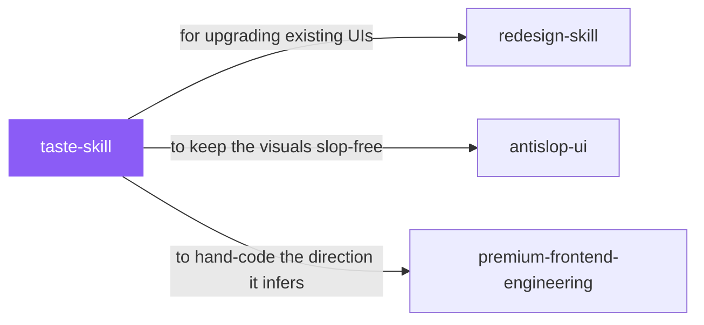

# taste-skill

 

*Open any AI-built landing page and you'll recognize it instantly: same hero, same three cards, same purple gradient. This skill exists because good design starts before any code — with reading the brief and choosing a direction on purpose.*

Anti-slop frontend skill for landing pages, portfolios, and redesigns. The agent reads the brief, infers the right design direction, and ships interfaces that do not look templated.

> Landing pages, portfolios, and redesigns. Not dashboards, not data tables, not multi-step product UI. Every rule below is contextual. None of it fires automatically. First read the brief, then pull only what fits.

## When to use

- Building a landing page, portfolio, or marketing site from a loose brief
- You want the agent to infer a design direction instead of defaulting to generic AI aesthetics
- Redesigning something that currently looks AI-generated

## Contents

```
taste-skill/
├── SKILL.md  # the playbook — when to load, how to apply
└── skill.yaml  # machine-readable metadata
```

## Pairs well with



Also: [`redesign-skill`](../redesign-skill/), [`antislop-ui`](../../writing/antislop-ui/), [`premium-frontend-engineering`](../premium-frontend-engineering/)

## Install

```sh
cp -r design/taste-skill ~/.claude/skills/  # or your agent's skills directory
```

## Source

Adapted from [Leonxlnx/taste-skill](https://github.com/Leonxlnx/taste-skill) (MIT), curated into atlys by [adiprmx](https://github.com/adiprmx).

---

Part of [atlys](../../) — a curated collection of skills for AI coding agents.
