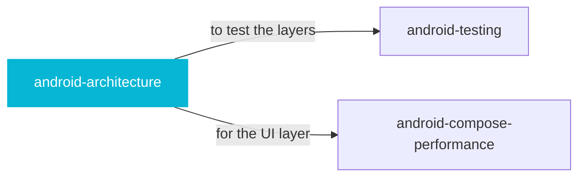

# android-architecture

 

*Activities calling the network directly is how Android apps become unmaintainable. Clean layers, Hilt wiring, boundaries that hold.*

Expert guidance on setting up and maintaining a modern Android application architecture using Clean Architecture and Hilt. Use this when asked about project structure, module setup, or dependency injection.

## When to use

- Structuring an Android app with Clean Architecture and Hilt
- Enforcing layer boundaries in a growing codebase

## Contents

```
android-architecture/
└── SKILL.md  # the playbook — when to load, how to apply
```

## Pairs well with



Also: [`android-testing`](../engineering/android-testing/), [`android-compose-performance`](../engineering/android-compose-performance/)

## Install

```sh
cp -r engineering/android-architecture ~/.claude/skills/  # or your agent's skills directory
```

## Source

Adapted from [new-silvermoon/awesome-android-agent-skills](https://github.com/new-silvermoon/awesome-android-agent-skills) (Apache-2.0), curated into atlys by [adiprmx](https://github.com/adiprmx).

---

Part of [atlys](../../) — a curated collection of skills for AI coding agents.
