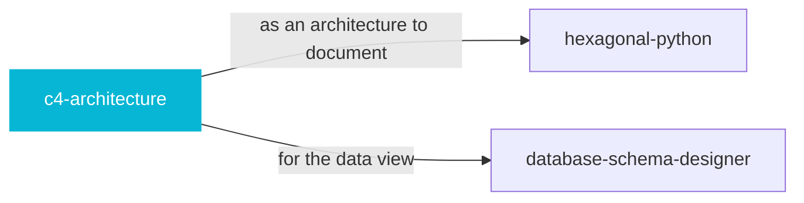

# c4-architecture

 

*Nobody reads a forty-page architecture doc. Four diagrams — context, container, component, code — that a new hire can absorb in an hour.*

Generate architecture documentation using C4 model Mermaid diagrams. Use when asked to create architecture diagrams, document system architecture, visualize software structure, create C4 diagrams, or generate context/container/component/deployment diagrams.

## When to use

- Documenting system architecture with C4 diagrams
- Context, container, component, and code views

## Contents

```
c4-architecture/
├── references/  # reference docs
└── SKILL.md  # the playbook — when to load, how to apply
```

## Pairs well with



Also: [`hexagonal-python`](../hexagonal-python/), [`database-schema-designer`](../database-schema-designer/)

## Install

```sh
cp -r engineering/c4-architecture ~/.claude/skills/  # or your agent's skills directory
```

## Source

Adapted from [softaworks/agent-toolkit](https://github.com/softaworks/agent-toolkit) (MIT), curated into atlys by [adiprmx](https://github.com/adiprmx).

---

Part of [atlys](../../) — a curated collection of skills for AI coding agents.
