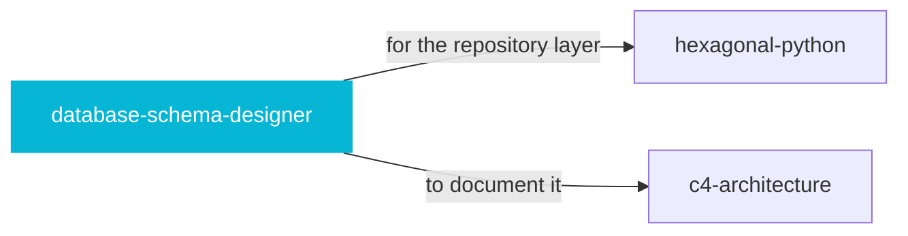

# database-schema-designer

 

*Schema mistakes are the most expensive kind — they outlive every refactor. Get normalization, indexing, and migrations right up front.*

Design robust, scalable database schemas for SQL and NoSQL databases. Provides normalization guidelines, indexing strategies, migration patterns, constraint design, and performance optimization.

## When to use

- Designing a new database schema, SQL or NoSQL
- Reviewing normalization, indexing, and migration strategy

## Contents

```
database-schema-designer/
├── assets/  # assets
├── references/  # reference docs
└── SKILL.md  # the playbook — when to load, how to apply
```

## Pairs well with



Also: [`hexagonal-python`](../hexagonal-python/), [`c4-architecture`](../c4-architecture/)

## Install

```sh
cp -r engineering/database-schema-designer ~/.claude/skills/  # or your agent's skills directory
```

## Source

Adapted from [softaworks/agent-toolkit](https://github.com/softaworks/agent-toolkit) (MIT), curated into atlys by [adiprmx](https://github.com/adiprmx).

---

Part of [atlys](../../) — a curated collection of skills for AI coding agents.
