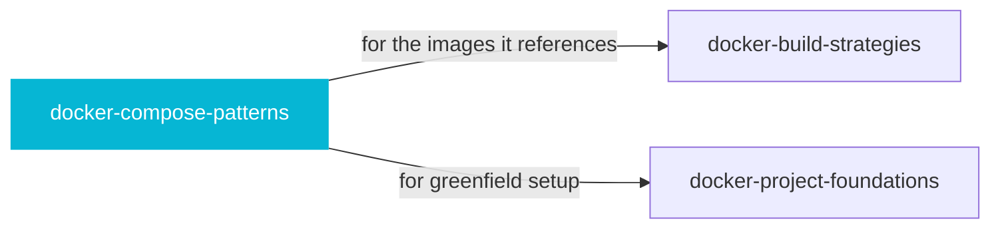

# docker-compose-patterns

 

*Compose files grow by copy-paste until nobody understands the startup order. This is the disciplined way: health checks, dependencies, overrides.*

Use this skill when creating, modifying, or debugging Docker Compose configurations, even if the user just says they need to wire services together, add a database to their stack, or set up a local development environment with multiple containers. Covers service definitions, health checks, dependency ordering, volumes, networks, environment variables, and development overrides.

## When to use

- Creating, modifying, or debugging docker-compose.yaml
- Wiring services, health checks, volumes, and networks

## Contents

```
docker-compose-patterns/
├── agents/  # subagent definitions
├── assets/  # assets
├── checks/  # check scripts
├── references/  # reference docs
├── scripts/  # helper scripts
├── SKILL.md  # the playbook — when to load, how to apply
└── skill.yaml  # machine-readable metadata
```

## Pairs well with



Also: [`docker-build-strategies`](../engineering/docker-build-strategies/), [`docker-project-foundations`](../engineering/docker-project-foundations/)

## Install

```sh
cp -r engineering/docker-compose-patterns ~/.claude/skills/  # or your agent's skills directory
```

## Source

Adapted from [docker/skills](https://github.com/docker/skills) (Apache-2.0), curated into atlys by [adiprmx](https://github.com/adiprmx).

---

Part of [atlys](../../) — a curated collection of skills for AI coding agents.
