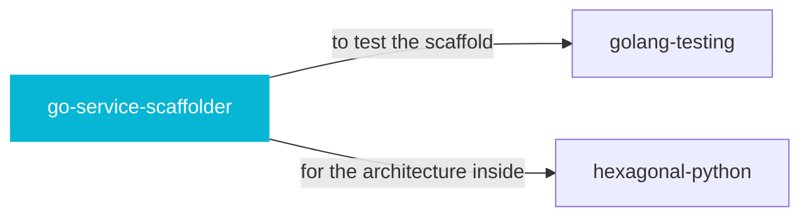

# go-service-scaffolder

 

*Every new service needs the same boring excellence: observability, TLS, graceful shutdown, CI. Scaffold it once, correctly.*

Scaffold a production-ready Go HTTP service with OpenTelemetry observability, TLS, lifecycle management, Dockerfile, GitHub Actions CI/CD, and golangci-lint. Use when creating or regenerating a full Go service skeleton (project layout, config package, server package, CI workflows, and container build files).

## When to use

- Scaffolding a new production Go HTTP service
- You want observability, TLS, graceful shutdown, and CI out of the box

## Contents

```
go-service-scaffolder/
├── references/  # reference docs
└── SKILL.md  # the playbook — when to load, how to apply
```

## Pairs well with



Also: [`golang-testing`](../golang-testing/), [`hexagonal-python`](../hexagonal-python/)

## Install

```sh
cp -r engineering/go-service-scaffolder ~/.claude/skills/  # or your agent's skills directory
```

## Source

Adapted from [ItalyPaleAle/skills](https://github.com/ItalyPaleAle/skills) (MIT), curated into atlys by [adiprmx](https://github.com/adiprmx).

---

Part of [atlys](../../) — a curated collection of skills for AI coding agents.
