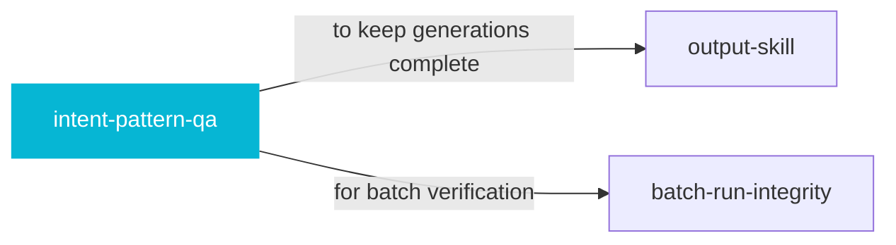

# intent-pattern-qa

 

*Regex that compiles but never matches is a silent bug — everything looks fine, nothing ever fires. This hunts those down with proof.*

Dynamic QA checklist that catches silent regex-pattern death (patterns that compile but never match) via positive-match probes and byte-level asserts — use when authoring or verifying intent batches.

## When to use

- You maintain regex pattern sets (intents, classifiers)
- Some patterns compile fine but might never match anything

## Contents

```
intent-pattern-qa/
├── SKILL.md  # the playbook — when to load, how to apply
└── skill.yaml  # machine-readable metadata
```

## Pairs well with



Also: [`output-skill`](../output-skill/), [`batch-run-integrity`](../batch-run-integrity/)

## Install

```sh
cp -r engineering/intent-pattern-qa ~/.claude/skills/  # or your agent's skills directory
```

## Source

Original to atlys — created and curated by [adiprmx](https://github.com/adiprmx).

---

Part of [atlys](../../) — a curated collection of skills for AI coding agents.
