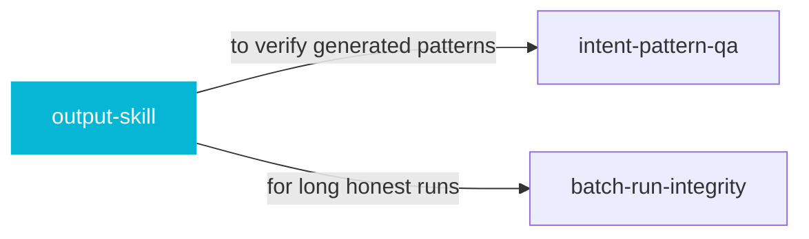

# output-skill

 

*The classic agent failure: code that trails off into placeholder comments. This bans truncation and placeholders, period.*

Overrides default LLM truncation behavior. Enforces complete code generation, bans placeholder patterns, and handles token-limit splits cleanly.

## When to use

- The agent keeps truncating code or leaving placeholder comments
- Long generations that must survive token limits cleanly

## Contents

```
output-skill/
├── SKILL.md  # the playbook — when to load, how to apply
└── skill.yaml  # machine-readable metadata
```

## Pairs well with



Also: [`intent-pattern-qa`](../intent-pattern-qa/), [`batch-run-integrity`](../batch-run-integrity/)

## Install

```sh
cp -r engineering/output-skill ~/.claude/skills/  # or your agent's skills directory
```

## Source

Adapted from [Leonxlnx/taste-skill](https://github.com/Leonxlnx/taste-skill) (MIT), curated into atlys by [adiprmx](https://github.com/adiprmx).

---

Part of [atlys](../../) — a curated collection of skills for AI coding agents.
