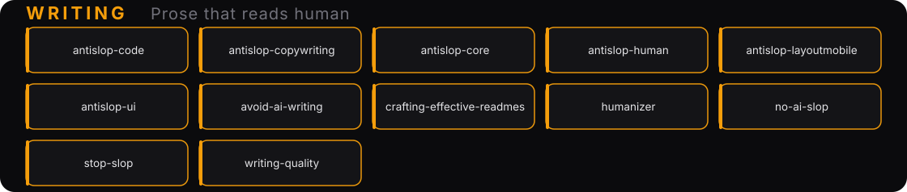

# ✍️ Anti-AI-slop writing

12 skills for prose that reads human, not generated.

Two jobs here: **de-slopping** (strip the AI tics — em-dashes everywhere, "delve", "moreover", hollow parallelism) and **quality** (structure, clarity, voice). The antislop family is the always-on filter; the rest are specialists you load per task.

> New here? Start with `antislop-core` (the always-on filter), `humanizer` (fix the voice), and `stop-slop` (cut the filler).

| Skill | What it does |
|---|---|
| `antislop-core` | The core filter. Rules every AI coding agent should follow to stop generic AI slop. Load always. |
| `antislop-ui` | The visual companion to the core: color, layout, components, and motion without the slop. |
| `antislop-copywriting` | Headlines, tone, CTAs, and anti-AI-writing patterns for prose that persuades. |
| `antislop-code` | Code comment hygiene: strip generic AI-slop comments, keep the valuable ones, never touch the code. |
| `antislop-human` | Human-first and accessible: contrast, keyboard, focus, and states for real people. Ships a contrast checker. |
| `antislop-layoutmobile` | Layouts that reflow gracefully from phone to desktop: grids, overflow, tap targets. |
| `humanizer` | Turns AI-scented writing into human-sounding prose without changing the content. Built on Wikipedia's *"Signs of AI writing"* research. |
| `stop-slop` | Cuts AI rhetoric and filler: 8 core rules, banned-phrase lists, quick checks, and per-dimension scoring. |
| `no-ai-slop` | Two modes — **Edit** (minimum effective edit, with a changelog) and **Detect** (name the pattern, quote the line, suggest the fix). |
| `avoid-ai-writing` | A strict editing contract (detect ≠ judge ≠ edit), tiered pattern catalog, voice profiles, and iterate-to-convergence passes. |
| `crafting-effective-readmes` | README writing matched to your audience — templates and guidance for READMEs that actually get read. |
| `writing-quality` | Applies to every turn that drafts human-facing prose (chat replies, explanations, emails). Quality from a different angle than de-slopping. |

← Back to [atlys](../)
