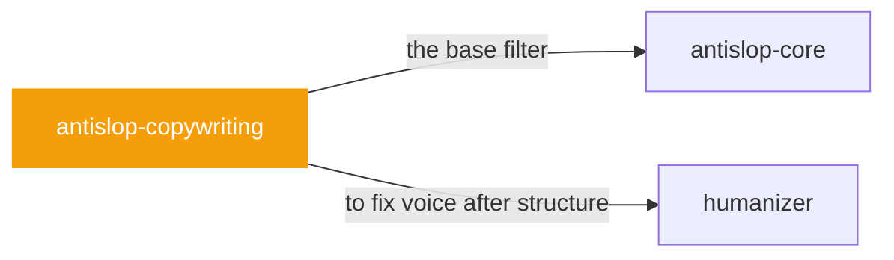

# antislop-copywriting

 

*Most AI copy is interchangeable: swap the product name and nothing changes. This is about writing that could only be about your thing.*

Copy and text skill for antislop. Use when writing or editing prose: headlines, tone, CTAs, and anti-AI-writing patterns.

> Anti Slop: Rules for AI Coding Agents. Copy & Text skill Part of the antislop system. Read together with antislop.md (the core). This skill deep-dives the copy and text concern: headlines, CTAs, tone, value propositions, and the patterns that make AI-written prose easy to spot. It references core rules by number and never duplicates or renumbers them. Load it when the task writes or edits marketing copy, product copy, landing-page text, or any prose meant for people to read.

## When to use

- Writing headlines, landing copy, CTAs
- Marketing prose that reads flat and interchangeable

## Contents

```
antislop-copywriting/
└── SKILL.md  # the playbook — when to load, how to apply
```

## Pairs well with



Also: [`antislop-core`](../antislop-core/), [`humanizer`](../humanizer/)

## Install

```sh
cp -r writing/antislop-copywriting ~/.claude/skills/  # or your agent's skills directory
```

## Source

Adapted from [miqdadbadjuber/anti-slop](https://github.com/miqdadbadjuber/anti-slop) (MIT), curated into atlys by [adiprmx](https://github.com/adiprmx).

---

Part of [atlys](../../) — a curated collection of skills for AI coding agents.
