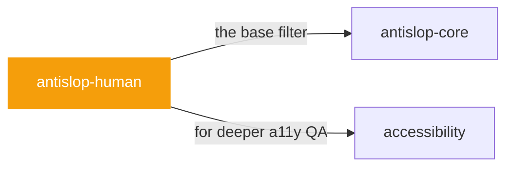

# antislop-human

 

*Designed for screenshots, broken for people. Contrast ratios, keyboard paths, focus states — the unglamorous checks that decide whether humans can actually use it.*

Human and accessibility skill for antislop. Contrast, keyboard, focus, and states for real people.

> Anti Slop: Rules for AI Coding Agents. Human skill Part of the antislop system. Read together with antislop.md (the core). This skill deep-dives the human concern: the UI must stay usable by people with different eyes, hands, and setups. Contrast, keyboard, focus, states, and the mobile details that exclude people.

## When to use

- Accessibility review: contrast, keyboard, focus, states
- Designing for real people, not screenshots

## Contents

```
antislop-human/
├── SKILL.md  # the playbook — when to load, how to apply
├── contrast-check.py
└── contrast-mcp.py
```

## Pairs well with



Also: [`antislop-core`](../antislop-core/), [`accessibility`](../../design/accessibility/)

## Install

```sh
cp -r writing/antislop-human ~/.claude/skills/  # or your agent's skills directory
```

## Source

Adapted from [miqdadbadjuber/anti-slop](https://github.com/miqdadbadjuber/anti-slop) (MIT), curated into atlys by [adiprmx](https://github.com/adiprmx).

---

Part of [atlys](../../) — a curated collection of skills for AI coding agents.
