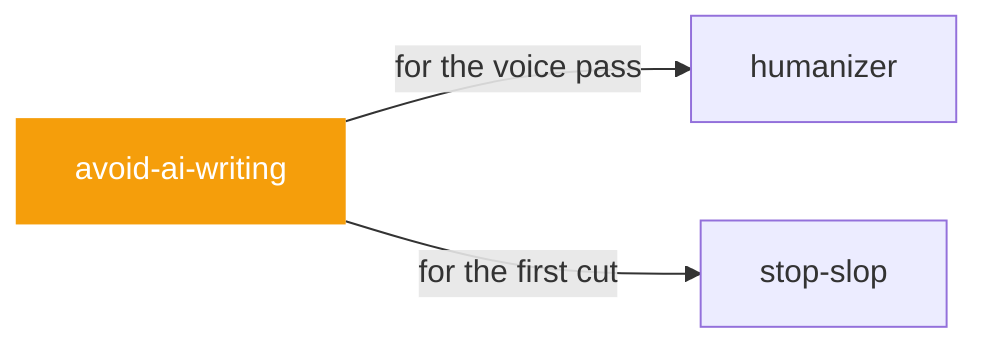

# avoid-ai-writing

 

*For when 'make it sound human' needs to be a repeatable process, not a vibe. Strict contract, tiered patterns, iterate until it converges.*

Avoid AI Writing: audit & rewrite untuk menghapus pola tulisan AI ('AI-isms'). Mode detect-only, edit-in-place, profil suara (casual/professional/technical/warm/blunt), dan pass iterasi-sampai-konvergen.

> Sumber: conorbronsdon/avoid-ai-writing v3.38.0 (MIT) oleh Conor Bronsdon. Diringkas dan diadaptasi ke Bahasa Indonesia; katalog pola penuh ada di repo sumber (references/patterns.md). Catatan bahasa: aturan dan detektor ini dikalibrasi untuk Bahasa Inggris. Untuk Bahasa Indonesia, pakai sebagai panduan pola STRUKTURAL (kontras biner, triad, staging, inflasi) — bukan daftar kata per kata.

## When to use

- You need a strict, repeatable editing contract
- Iterating a draft to convergence across multiple passes

## Contents

```
avoid-ai-writing/
└── SKILL.md  # the playbook — when to load, how to apply
```

## Pairs well with



Also: [`humanizer`](../writing/humanizer/), [`stop-slop`](../writing/stop-slop/)

## Install

```sh
cp -r writing/avoid-ai-writing ~/.claude/skills/  # or your agent's skills directory
```

## Source

Adapted from [conorbronsdon/avoid-ai-writing](https://github.com/conorbronsdon/avoid-ai-writing) (MIT), curated into atlys by [adiprmx](https://github.com/adiprmx).

---

Part of [atlys](../../) — a curated collection of skills for AI coding agents.
