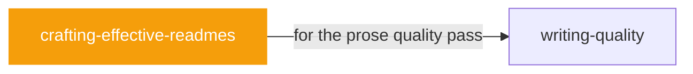

# crafting-effective-readmes

 

*Nobody reads READMEs that read like documentation. This is about writing the one page that decides whether someone tries your project.*

Use when writing or improving README files. Not all READMEs are the same — provides templates and guidance matched to your audience and project type.

## When to use

- Writing or rewriting a project README
- READMEs people actually read instead of skimming past

## Contents

```
crafting-effective-readmes/
├── references/  # reference docs
├── templates/  # templates
├── SKILL.md  # the playbook — when to load, how to apply
├── section-checklist.md
├── style-guide.md
└── using-references.md
```

## Pairs well with



Also: [`writing-quality`](../writing-quality/)

## Install

```sh
cp -r writing/crafting-effective-readmes ~/.claude/skills/  # or your agent's skills directory
```

## Source

Adapted from [softaworks/agent-toolkit](https://github.com/softaworks/agent-toolkit) (MIT), curated into atlys by [adiprmx](https://github.com/adiprmx).

---

Part of [atlys](../../) — a curated collection of skills for AI coding agents.
