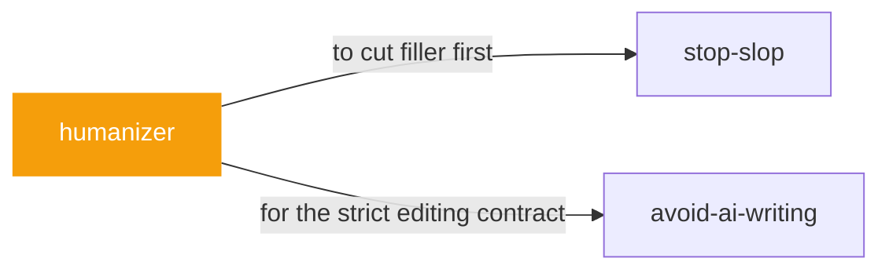

# humanizer

 

*Some drafts are correct and still unreadable — you can smell the AI in the rhythm. This keeps every fact and changes the voice into something human.*

Humanizer: ubah tulisan beraroma AI jadi terdengar seperti manusia tanpa mengubah isinya. Pakai saat mengedit/mereview prosa: deteksi pola AI (kontras not-X-but-Y, closer satu baris, triad paksa, dash berlebih, klaim bombastis, kata stok AI, bold dekoratif, sisa chat).

> Sumber: blader/humanizer (MIT) — pola dari Wikipedia "Signs of AI writing". Diadaptasi ke Bahasa Indonesia; pola dan contoh Inggris dipertahankan karena polanya spesifik Bahasa Inggris.

## When to use

- A draft is correct but smells like AI
- Keep the content, change the voice

## Contents

```
humanizer/
└── SKILL.md  # the playbook — when to load, how to apply
```

## Pairs well with



Also: [`stop-slop`](../writing/stop-slop/), [`avoid-ai-writing`](../writing/avoid-ai-writing/)

## Install

```sh
cp -r writing/humanizer ~/.claude/skills/  # or your agent's skills directory
```

## Source

Adapted from [blader/humanizer](https://github.com/blader/humanizer) (MIT), curated into atlys by [adiprmx](https://github.com/adiprmx).

---

Part of [atlys](../../) — a curated collection of skills for AI coding agents.
