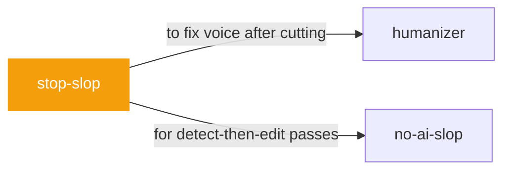

# stop-slop

 

*First drafts drown in throat-clearing. This cuts with a scalpel and scores what it did, so you can see the before and after.*

Stop Slop: pangkas retorika & basa-basi AI dari prosa. 8 aturan inti (potong filler, hancurkan struktur formulaik, aktif, spesifik, variasi ritme) + daftar frasa yang wajib dibuang + cek kilat + skor 1-10 per dimensi.

> Sumber: hardikpandya/stop-slop (MIT) oleh Hardik Pandya. Diadaptasi ke Bahasa Indonesia; daftar frasa Inggris dipertahankan karena polanya spesifik Bahasa Inggris.

## When to use

- Cutting filler, throat-clearing, and AI rhetoric from a draft
- You want a scored pass with specific fixes

## Contents

```
stop-slop/
└── SKILL.md  # the playbook — when to load, how to apply
```

## Pairs well with



Also: [`humanizer`](../humanizer/), [`no-ai-slop`](../no-ai-slop/)

## Install

```sh
cp -r writing/stop-slop ~/.claude/skills/  # or your agent's skills directory
```

## Source

Adapted from [hardikpandya/stop-slop](https://github.com/hardikpandya/stop-slop) (MIT), curated into atlys by [adiprmx](https://github.com/adiprmx).

---

Part of [atlys](../../) — a curated collection of skills for AI coding agents.
