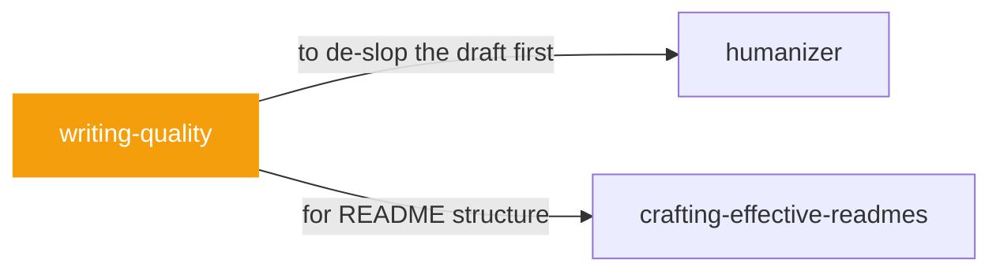

# writing-quality

 

*Every chat reply, every explanation, every email the agent drafts — this is the quality bar for all of it.*

Apply on every turn that drafts or edits human-facing prose, even when writing is not the main task. Covers chat replies, explanations, emails, documents, pull request descriptions, issue comments, and review reports.

## When to use

- Any agent turn drafting human-facing prose
- Chat replies, explanations, and emails that need to read well

## Contents

```
writing-quality/
├── agents/  # subagent definitions
├── references/  # reference docs
├── NOTICE
└── SKILL.md  # the playbook — when to load, how to apply
```

## Pairs well with



Also: [`humanizer`](../humanizer/), [`crafting-effective-readmes`](../crafting-effective-readmes/)

## Install

```sh
cp -r writing/writing-quality ~/.claude/skills/  # or your agent's skills directory
```

## Source

Adapted from [ItalyPaleAle/skills](https://github.com/ItalyPaleAle/skills) (MIT), curated into atlys by [adiprmx](https://github.com/adiprmx).

---

Part of [atlys](../../) — a curated collection of skills for AI coding agents.
